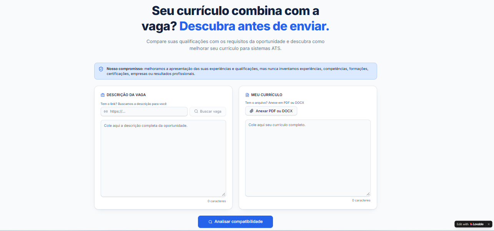
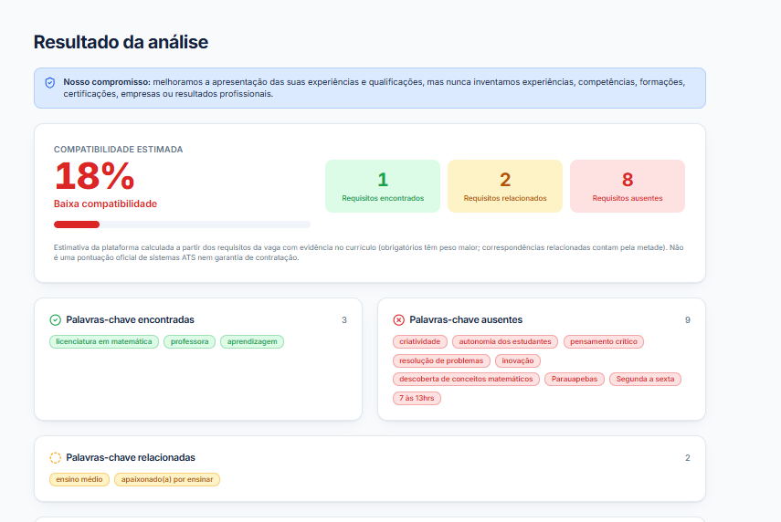
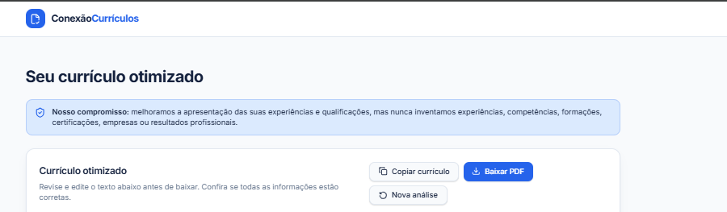

# ConexãoCurrículos

### Conectando talentos às oportunidades por meio da inteligência artificial.

O **ConexãoCurrículos** é uma aplicação web desenvolvida com auxílio de inteligência artificial, utilizando a plataforma Lovable, que permite analisar a compatibilidade entre um currículo profissional e uma descrição de vaga. A ferramenta identifica palavras-chave, destaca pontos fortes, aponta requisitos que podem ser melhor evidenciados e gera uma versão otimizada do currículo para sistemas de recrutamento ATS (*Applicant Tracking Systems*).

O projeto foi desenvolvido no contexto do laboratório de Inteligência Artificial da DIO, com o objetivo de aplicar IA generativa na resolução de um problema real enfrentado por pessoas que estão em busca de oportunidades profissionais.

---

## 1. O problema escolhido

A procura por uma oportunidade profissional envolve diversos desafios. Um deles é adaptar o currículo às exigências específicas de cada vaga.

Muitas empresas utilizam sistemas ATS (*Applicant Tracking Systems*) para organizar e realizar uma triagem inicial dos currículos recebidos. Esses sistemas podem considerar palavras-chave, competências, experiências e outros requisitos presentes na descrição da oportunidade.

Nesse contexto, um currículo que não apresenta de maneira clara as informações relacionadas à vaga pode deixar de evidenciar qualificações relevantes do candidato.

Entre as dificuldades enfrentadas por quem procura emprego, destacam-se:

- Dificuldade para identificar as palavras-chave presentes na descrição de uma vaga;
- Falta de clareza sobre a compatibilidade entre o perfil profissional e os requisitos solicitados;
- Dificuldade para adaptar o currículo a diferentes oportunidades;
- Desconhecimento sobre a organização e a apresentação de informações em formatos adequados para sistemas ATS;
- Tempo gasto na revisão e reformulação de currículos para cada candidatura.

A proposta surgiu da necessidade de tornar esse processo mais acessível, organizado e estratégico.

## 2. A solução proposta

O ConexãoCurrículos foi desenvolvido para auxiliar candidatos na análise e adequação de seus currículos às oportunidades profissionais.

Por meio da inteligência artificial, a aplicação compara as informações do currículo com os requisitos da vaga, apresenta uma estimativa de compatibilidade e sugere melhorias na organização do documento.

A ferramenta não substitui a avaliação humana nem garante aprovação em processos seletivos. Seu objetivo é ajudar o candidato a compreender melhor as exigências da oportunidade e apresentar suas qualificações de maneira mais clara.

### Público-alvo

- Pessoas em busca do primeiro emprego;
- Profissionais em transição de carreira;
- Candidatos que desejam concorrer a diferentes oportunidades;
- Pessoas que precisam melhorar a organização e a apresentação de seus currículos.

## 3. Funcionalidades implementadas

O MVP desenvolvido contempla as seguintes funcionalidades:

| Funcionalidade | Descrição |
|---|---|
| Anexar currículo | Permite enviar arquivos nos formatos PDF e DOCX. |
| Inserir currículo por texto | Permite colar o conteúdo diretamente na aplicação. |
| Importar vaga por link | Permite informar o endereço de uma oportunidade para tentar obter sua descrição. |
| Inserir descrição da vaga | Permite colar manualmente os requisitos da oportunidade. |
| Análise de compatibilidade | Compara o currículo com os requisitos identificados na vaga. |
| Pontuação de compatibilidade | Apresenta uma estimativa percentual de correspondência. |
| Análise de palavras-chave | Identifica requisitos encontrados, relacionados e ausentes. |
| Pontos fortes | Destaca aspectos do currículo relacionados à oportunidade. |
| Recomendações | Apresenta sugestões para melhorar a adequação do currículo. |
| Currículo otimizado | Gera uma versão reorganizada e ajustada às exigências da vaga. |
| Edição do resultado | Permite editar o currículo otimizado antes da exportação. |
| Copiar currículo | Permite copiar o conteúdo gerado. |
| Exportar PDF | Permite baixar o currículo otimizado em PDF. |

## 4. Como funciona a aplicação

O funcionamento foi organizado em etapas para facilitar a utilização.

### Etapa 1 — Inserção das informações

O usuário informa a descrição da vaga e o conteúdo do currículo.

É possível anexar um arquivo PDF ou DOCX, colar o texto diretamente ou informar um link de uma oportunidade profissional.

### Etapa 2 — Obtenção da descrição da vaga

Quando o usuário informa um link, a aplicação tenta recuperar as informações disponíveis na página da oportunidade.

Caso o site não permita a leitura automática, o usuário pode inserir manualmente a descrição da vaga.

### Etapa 3 — Análise de compatibilidade

A inteligência artificial compara as informações do currículo com os requisitos da oportunidade.

A análise considera os requisitos identificados e as evidências presentes no currículo, classificando-os em três categorias:

- **Encontrados:** requisitos identificados diretamente nas informações do currículo;
- **Relacionados:** informações que apresentam relação com o requisito, mas não correspondem integralmente a ele;
- **Ausentes:** requisitos para os quais não foram identificadas evidências suficientes.

Os requisitos obrigatórios possuem peso maior na composição da estimativa de compatibilidade. Os requisitos relacionados recebem pontuação parcial.

### Etapa 4 — Apresentação dos resultados

A aplicação apresenta:

- Percentual estimado de compatibilidade;
- Quantidade de requisitos encontrados, relacionados e ausentes;
- Palavras-chave identificadas;
- Pontos fortes do currículo;
- Recomendações de melhoria.

### Etapa 5 — Geração do currículo otimizado

Com base na análise, a inteligência artificial produz uma versão reorganizada do currículo, buscando destacar as informações mais relevantes para a oportunidade.

O resultado pode ser editado pelo usuário, copiado ou exportado em PDF.

### Regra fundamental do projeto

A otimização não deve criar experiências profissionais, competências, qualificações ou informações que não tenham sido fornecidas pelo candidato.

A inteligência artificial deve trabalhar com os dados existentes, melhorando sua organização, clareza e apresentação.

## 5. Desenvolvimento com inteligência artificial

A aplicação foi construída utilizando o Lovable, a partir de um mega prompt elaborado para orientar a criação do MVP.

O desenvolvimento ocorreu de maneira iterativa: primeiro foi definida a estrutura principal da aplicação e, posteriormente, foram solicitados ajustes para ampliar as possibilidades de entrada de informações.

### 5.1. Mega prompt utilizado

O prompt inicial foi elaborado para orientar a criação de uma aplicação de análise de currículos compatível com as necessidades de sistemas ATS.

A especificação final estabeleceu os seguintes requisitos:

- Criar uma aplicação web chamada ConexãoCurrículos;
- Desenvolver uma interface intuitiva e responsiva;
- Permitir a inserção de currículo e descrição da vaga;
- Implementar análise de compatibilidade com inteligência artificial;
- Apresentar pontuação estimada de correspondência;
- Identificar palavras-chave encontradas, relacionadas e ausentes;
- Apresentar pontos fortes e recomendações;
- Gerar uma versão otimizada do currículo;
- Permitir edição, cópia e exportação do resultado em PDF;
- Não inventar informações profissionais;
- Não implementar funcionalidades desnecessárias ao MVP, como login, cadastro, histórico e banco de dados.

A arquitetura visual solicitada utilizou uma identidade baseada em tons de azul, azul-marinho, branco e cinza, buscando transmitir profissionalismo, clareza e confiança.

### 5.2. Evolução do prompt

Durante o desenvolvimento, a proposta inicial foi simplificada para priorizar o funcionamento das funcionalidades essenciais.

| Versão | Alterações |
|---|---|
| Primeira especificação | Definição da aplicação, identidade visual, análise de compatibilidade e geração de currículo otimizado. |
| Revisão do escopo | Priorização do MVP, retirando funcionalidades complementares que não eram essenciais ao desafio. |
| Ajuste após a primeira geração | Inclusão de anexos de currículo em PDF e DOCX. |
| Ajuste de importação | Inclusão da possibilidade de informar um link de uma vaga e tentar recuperar sua descrição automaticamente. |
| Versão final | Análise integrada, classificação de requisitos, recomendações, edição do currículo e exportação em PDF. |

### 5.3. Ajustes solicitados após a primeira geração

Após a primeira versão funcional, foi identificada uma oportunidade de melhorar a experiência de utilização.

Inicialmente, o usuário precisava inserir manualmente o conteúdo do currículo e da descrição da vaga.

Para reduzir essa dificuldade, foi solicitado ao Lovable:

**"Coloque para anexar o currículo em DOCX ou PDF e, na descrição da vaga, também anexar o link ou apenas anexar o link para que ele obtenha os dados necessários."**

A partir dessa solicitação, foram implementados:

- Extração de texto de arquivos PDF e DOCX diretamente no navegador;
- Preenchimento do campo de currículo com o conteúdo extraído;
- Busca da descrição da vaga a partir de um link;
- Possibilidade de iniciar a análise diretamente com o link da oportunidade.

Esses ajustes foram realizados para tornar a ferramenta mais prática e aproximar seu funcionamento das necessidades reais de quem procura emprego.

## 6. Tecnologias e ferramentas

O projeto foi desenvolvido com auxílio das seguintes ferramentas e tecnologias:

- **Lovable:** plataforma utilizada para criação e desenvolvimento da aplicação;
- **Inteligência Artificial:** responsável pela análise de compatibilidade e geração do currículo otimizado;
- **GitHub:** plataforma destinada ao versionamento e à documentação do projeto.

A composição técnica detalhada do código-fonte poderá ser consultada após a exportação e sincronização do projeto com o GitHub.

## 7. Limitações conhecidas

Algumas limitações foram identificadas durante os testes:

- A importação automática de vagas depende da disponibilidade de acesso ao conteúdo da página;
- Sites que exigem autenticação ou bloqueiam acessos automatizados podem impedir a recuperação da descrição;
- Arquivos PDF compostos exclusivamente por imagens, sem camada de texto, não permitem extração textual direta;
- O formato DOC antigo não está contemplado, sendo aceitos PDF e DOCX;
- A pontuação apresentada é uma estimativa produzida pela análise da aplicação, não uma pontuação oficial de qualquer sistema ATS.

Quando a importação automática não funciona, o usuário pode inserir manualmente o texto da vaga.

### 7.1. Comportamento observado nos testes de reanálise

Durante a bateria de testes práticos, foi identificado um comportamento importante em relação à adaptação e reanálise do currículo:

- **Estagnação da porcentagem de compatibilidade:** Embora o sistema gere com sucesso uma nova versão textual do currículo com as alterações sugeridas, a pontuação/porcentagem de compatibilidade exibida pela ferramenta não aumentou proporcionalmente após a adaptação.
- **Causa provável:** O motor de cálculo de compatibilidade atual ainda avalia de forma estática os dados brutos inicialmente inseridos, ou exige uma reanálise via prompt mais agressivo na injeção direta de palavras-chave exatas requeridas pela vaga.
- **Oportunidade para próximas versões:** Implementar uma rotina de recalculo dinâmico da pontuação após a edição/geração do novo currículo, garantindo que o usuário veja visualmente o aumento da taxa de compatibilidade (*feedback loop* em tempo real).

## 8. Evidências de funcionamento

### 1. Tela Inicial da Aplicação

### 2. Análise de Compatibilidade

### 3. Currículo Otimizado

## 9. Aplicação publicada

A aplicação está disponível publicamente no Lovable.

**Endereço da aplicação:**

https://vacancy-to-valor.lovable.app

**Repositório GitHub:**

https://github.com/Jucy-Fonsek/gerador-curriculo-ats-lovable

## 10. Considerações finais

O desenvolvimento do ConexãoCurrículos permitiu explorar a aplicação prática da inteligência artificial na resolução de um problema cotidiano relacionado à empregabilidade.

Mais do que gerar um currículo, a proposta busca auxiliar o candidato a compreender os requisitos de uma oportunidade, identificar informações relevantes em seu histórico profissional e melhorar a apresentação de suas qualificações.

O processo também demonstrou a importância da engenharia de prompts, da validação dos resultados gerados por inteligência artificial e da realização de ajustes a partir da experiência de utilização.

O projeto representa uma experiência prática de construção de uma solução digital com IA, desde a identificação do problema até a publicação de um MVP funcional.

---

**Projeto desenvolvido no Lab de Inteligência Artificial da DIO.**
